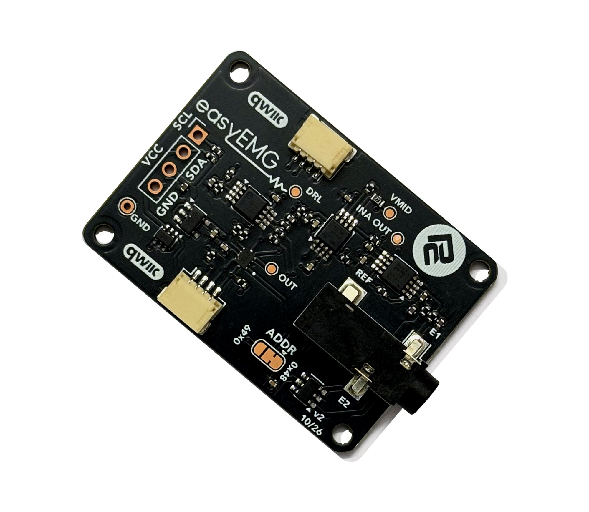

# Protocentral easyEMG MicroPython Library

[](https://github.com/Protocentral/protocentral-micropython-easyemg/actions/workflows/test.yml)
[](https://github.com/Protocentral/protocentral-micropython-easyemg/actions/workflows/publish.yml)

MicroPython library for the **Protocentral easyEMG Breakout**: single-channel surface EMG (sEMG) over I²C / Qwiic. It gives you the raw band-limited waveform and computes the RMS envelope in software. The same driver also runs on a Raspberry Pi.

## Don't have one? [Buy it here](https://protocentral.com/product/easyemg-surface-emg-breakout-qwiic/)



**Wiring, electrode placement and troubleshooting are in the [easyEMG Getting Started guide](https://protocentral.com/product/easyemg-surface-emg-breakout-qwiic/docs/getting-started/).**

## Links

| | |
|---|---|
| Product page | https://protocentral.com/product/easyemg-surface-emg-breakout-qwiic/ |
| Getting Started guide | https://protocentral.com/product/easyemg-surface-emg-breakout-qwiic/docs/getting-started/ |
| Arduino library | https://github.com/Protocentral/protocentral_easyemg_arduino |
| Hardware design files | https://github.com/Protocentral/protocentral_easyemg_hardware |

## Features

- Raw sEMG in µV at the electrodes, on a paced 500 SPS clock with missed-sample counting
- Sliding-window RMS envelope, activation threshold and %MVC
- `MvcRecorder`, the same MVC recording step as the Arduino OpenView sketch
- Optional mains notch (fundamental or every harmonic) and digital high-pass
- A port of the [Arduino library](https://github.com/Protocentral/protocentral_easyemg_arduino) 1.1.0: the same API in snake_case, and a Python version of every Arduino example

> **Not a medical device. For research and education only.** The breakout has no patient isolation: when electrodes are on a person, power the host from a battery or connect through an [easyISO isolated Qwiic adapter](https://protocentral.com/product/easyiso-isolated-qwiic-adapter/). On a mains-powered host you get no EMG at all.

## Installation

**MicroPython** (Raspberry Pi Pico, ESP32, …):

```bash
mpremote mip install github:Protocentral/protocentral-micropython-easyemg
```

This also installs the [TLA20xx driver](https://github.com/Protocentral/protocentral-micropython-tla20xx). With Thonny, copy `protocentral_easyemg.py` and `protocentral_tla20xx.py` to the board instead.

**Raspberry Pi**, with I²C enabled (`sudo raspi-config nonint do_i2c 0`):

```bash
python3 -m venv ~/easyemg && source ~/easyemg/bin/activate
pip install protocentral-easyemg
```

## Quick Start

```python
from machine import Pin, I2C
from protocentral_easyemg import EasyEMG

i2c = I2C(0, scl=Pin(5), sda=Pin(4), freq=400000)   # Pico: GP5, GP4. Change for your board
emg = EasyEMG(i2c)                                  # default address 0x48
if not emg.begin():
    raise OSError("easyEMG not found")
emg.calibrate_baseline()                            # muscle relaxed, electrodes on

n = 0
while True:
    if emg.update():                                # True once per sample, 500 SPS
        n += 1
        if n % 50 == 0:                             # print 10 times a second
            print(emg.last_envelope(), emg.missed_samples())
```

On a Raspberry Pi, replace the I²C lines with `from protocentral_tla20xx_linux import I2C` and `EasyEMG(I2C(bus=1))`.

Call `update()` as often as you can; it samples only when the clock is due, and never blocks. If `missed_samples()` grows, print less or lower the rate with `set_sample_rate()`. Filters need that same rate: `set_mains_notch(50, emg.sample_rate_hz())`.

## API Reference

| Method | Description |
|---|---|
| `EasyEMG(i2c, address=0x48)` / `begin()` | Construct / configure the ADC. `begin()` returns `False` if the board doesn't answer |
| `update()` | Non-blocking. Takes one sample when the clock is due; `True` if it did |
| `last_microvolts()` / `last_envelope()` | The latest sample and RMS envelope, in µV at the electrodes |
| `set_sample_rate(hz)` / `missed_samples()` | Paced clock, default 500 SPS / samples it couldn't take on time |
| `set_envelope_window(n)` | 1–128 samples, default 64 (128 ms at 500 SPS) |
| `set_mains_notch(hz, fs)` / `set_notch(hz, fs)` / `set_high_pass(hz, fs)` | Optional filters, off by default |
| `calibrate_baseline(n)` / `set_baseline(n)` | Measure and subtract the resting offset |
| `set_activation_threshold(uv)` / `is_active()` | Compare the envelope with a threshold |
| `set_mvc(uv)` / `read_percent_mvc()` / `MvcRecorder` | %MVC normalisation and the MVC recording step |

The full API, including the unpaced reads and low-level ADC passthroughs, is documented in [protocentral_easyemg.py](https://github.com/Protocentral/protocentral-micropython-easyemg/blob/main/protocentral_easyemg.py).

## Examples

| # | Example | Description |
|---|---|---|
| 01 | `easyemg_simpletest.py` / `easyemg_raspberrypi.py` | Raw µV and envelope (MicroPython / Raspberry Pi) |
| 02 | `easyemg_plotter.py` | sEMG and envelope for Thonny's plotter |
| 03 | `easyemg_calibration.py` | Baseline zeroing and your resting noise floor |
| 04 | `easyemg_envelope.py` | RMS envelope, MVC recording and %MVC |
| 05 | `easyemg_activation_led.py` | Flex to light an LED, with an automatic threshold and hysteresis |
| 06 | `easyemg_openview.py` | Stream to [OpenView](https://github.com/Protocentral/protocentral_openview) 3.4+ (**easyEMG Breakout**), with the MVC step. Save it to the board as `main.py`, then close Thonny or `mpremote` before connecting OpenView |
| 07 | `easyemg_diagnostics.py` | I²C, ADC, sample-rate, noise and mains-hum checks. **Run this first if something is wrong** |

The examples default to QT Py ESP32-C3 pins: change the `I2C(...)` line for your board.

## License

- **Software:** MIT, see [LICENSE.md](https://github.com/Protocentral/protocentral-micropython-easyemg/blob/main/LICENSE.md)
- **Hardware:** CERN-OHL-P v2, in the [hardware repo](https://github.com/Protocentral/protocentral_easyemg_hardware)

Copyright (c) 2026 Protocentral Electronics.

## Support

Open an issue on [GitHub](https://github.com/Protocentral/protocentral-micropython-easyemg/issues) or email support@protocentral.com.
